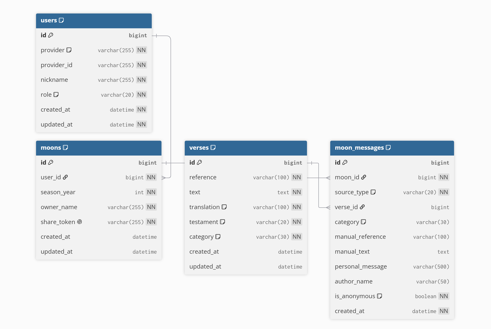

# Dama Backend 🌕

Dama 서비스의 사용자 인증, 보름달 생성, 메시지 저장 및 공개 시점 제어를 담당하는 Spring Boot 기반 백엔드 서버입니다.

<br>

## ✨ 주요 기능

- Kakao OAuth2 소셜 로그인
- Spring Security 기반 세션 인증
- 사용자 정보 조회 및 닉네임 변경
- 연도별 보름달 생성 및 조회
- 공유 토큰 기반 보름달 조회
- 공유받은 보름달에 메시지 작성
- 제공된 말씀 선택 또는 직접 입력
- 보름달에 작성된 메시지 개수 조회
- 추석 공개 시점에 따른 메시지 내용 접근 제어
- 관리자 계정의 메시지 사전 확인 지원

<br>

## 🛠 Tech Stack

### Backend

- Java 25
- Spring Boot 4.1.1
- Spring MVC
- Spring Data JPA
- Spring Security
- OAuth2 Client
- Hibernate
- Gradle
- Lombok

### Database

- MariaDB

### Deployment

- AWS EC2
- GitHub Actions
- systemd

<br>

## 📁 Project Structure

```text
src/main/java/com/dama/
├── config/
│   ├── SecurityConfig.java
│   └── WebConfig.java
│
├── controller/
│   ├── HealthController.java
│   ├── MoonController.java
│   ├── MoonMessageController.java
│   ├── UserController.java
│   └── VerseController.java
│
├── dto/
│   ├── MoonCreateRequest.java
│   ├── MoonMessageCreateRequest.java
│   ├── MoonMessageResponse.java
│   ├── MoonResponse.java
│   ├── UserMeResponse.java
│   ├── UserNicknameUpdateRequest.java
│   └── VerseResponse.java
│
├── entity/
│   ├── User.java
│   ├── Moon.java
│   ├── MoonMessage.java
│   ├── Verse.java
│   │
│   └── enums/
│       ├── SocialProvider.java
│       ├── SourceType.java
│       ├── Testament.java
│       ├── UserRole.java
│       └── VerseCategory.java
│
├── repository/
│   ├── UserRepository.java
│   ├── MoonRepository.java
│   ├── MoonMessageRepository.java
│   └── VerseRepository.java
│
├── service/
│   ├── CustomOAuth2UserService.java
│   ├── CustomOAuth2UserServiceImpl.java
│   ├── ChuseokOpenPolicy.java
│   ├── UserService.java
│   ├── UserServiceImpl.java
│   ├── MoonService.java
│   ├── MoonServiceImpl.java
│   ├── MoonMessageService.java
│   ├── MoonMessageServiceImpl.java
│   ├── VerseService.java
│   └── VerseServiceImpl.java
│
└── DamaApplication.java
```

<br>

## 🗃 ERD

<p align="center">
  
</p>

### 주요 Entity

```text
User
 │
 │ 1:N
 ▼
Moon
 │
 │ 1:N
 ▼
MoonMessage
 │
 │ N:1
 ▼
Verse
```

### User

소셜 로그인 사용자 정보를 관리합니다.

- OAuth Provider
- Provider ID
- 닉네임
- 사용자 권한

### Moon

사용자가 생성한 시즌별 보름달 정보를 관리합니다.

- 사용자
- 시즌 연도
- 보름달 주인 이름
- 공유 토큰

한 사용자는 같은 시즌에 하나의 보름달만 생성할 수 있습니다.

### MoonMessage

보름달에 작성된 말씀과 메시지를 관리합니다.

- 선택된 말씀 또는 직접 작성한 말씀
- 말씀 카테고리
- 개인 메시지
- 작성자 이름
- 익명 여부

### Verse

서비스에서 제공하는 말씀 데이터를 관리합니다.

<br>

## 🔐 Authentication

Dama는 Kakao OAuth2와 Spring Security를 이용해 사용자를 인증합니다.

```text
Client
   │
   ▼
Kakao OAuth2 Login
   │
   ▼
Spring Security
   │
   ▼
CustomOAuth2UserService
   │
   ├── 기존 사용자 조회
   │
   └── 신규 사용자 저장
   │
   ▼
HTTP Session
   │
   ▼
JSESSIONID
```

카카오 로그인에 성공하면 사용자 정보를 조회하여  
등록되지 않은 사용자인 경우 Dama의 `users` 테이블에 신규 사용자를 생성합니다.

인증이 필요한 API는 Spring Security Session을 통해 접근을 제어합니다.

로그인하지 않은 상태에서 `/api/**` 요청을 호출하면  
OAuth 로그인 페이지로 Redirect하지 않고 `401 Unauthorized`를 반환합니다.

<br>

## 🔓 API 접근 정책

인증 없이 접근할 수 있는 API와 로그인이 필요한 API를 구분했습니다.

### Public

- 서버 상태 확인
- 공유된 보름달 조회
- 공유된 보름달에 메시지 작성
- 말씀 목록 조회
- OAuth2 로그인

### Authentication Required

- 내 사용자 정보 조회
- 닉네임 변경
- 내 보름달 생성
- 내 보름달 조회
- 받은 메시지 조회
- 로그아웃

<br>

## 📡 API

### User

| Method | Endpoint | 설명 |
| --- | --- | --- |
| `GET` | `/api/v1/users/me` | 로그인 사용자 정보 조회 |
| `PATCH` | `/api/v1/users/me/nickname` | 닉네임 변경 |

### Moon

| Method | Endpoint | 설명 |
| --- | --- | --- |
| `POST` | `/api/v1/moons` | 보름달 생성 |
| `GET` | `/api/v1/moons/me?seasonYear={year}` | 내 시즌 보름달 조회 |
| `GET` | `/api/v1/moons/{moonId}` | 보름달 조회 |
| `GET` | `/api/v1/moons/share/{shareToken}` | 공유 토큰으로 보름달 조회 |

### Moon Message

| Method | Endpoint | 설명 |
| --- | --- | --- |
| `POST` | `/api/v1/moons/share/{shareToken}/messages` | 공유 보름달에 메시지 작성 |
| `GET` | `/api/v1/moons/{moonId}/messages` | 받은 메시지 목록 조회 |
| `GET` | `/api/v1/moons/share/{shareToken}/messages/count` | 보름달 메시지 개수 조회 |

### Verse

| Method | Endpoint | 설명 |
| --- | --- | --- |
| `GET` | `/api/v1/verses` | 제공되는 말씀 목록 조회 |

### Health

| Method | Endpoint | 설명 |
| --- | --- | --- |
| `GET` | `/api/v1/health` | 서버 상태 확인 |

<br>

## 🌕 Message Open Policy

보름달에 작성된 메시지는 지정된 추석 공개 시점 이후에 확인할 수 있도록 구현했습니다.

```text
메시지 조회 요청
      │
      ▼
ChuseokOpenPolicy
      │
      ├── 공개 시점 이전 → 메시지 내용 잠금
      │
      └── 공개 시점 이후 → 전체 메시지 반환
```

2026년 서비스의 공개 시점은 다음과 같이 설정되어 있습니다.

```text
2026-09-25 00:00 KST
```

관리자는 테스트 및 운영 확인을 위해 공개 시점 이전에도 메시지를 확인할 수 있으며,  
일반 사용자 화면을 확인하기 위한 Preview 옵션도 제공합니다.

<br>

## 🚀 CI/CD

`main` 브랜치에 Push되면 GitHub Actions를 통해 자동으로 빌드 및 배포됩니다.

```text
GitHub
   │
   ▼
GitHub Actions
   │
   ├── MariaDB Test Service 실행
   │
   ├── Java 25 설정
   │
   ├── Gradle Build
   │
   ▼
JAR Artifact
   │
   ▼
SSH / SCP
   │
   ▼
AWS EC2
   │
   ▼
systemd
   │
   ▼
Spring Boot
```

### CI

Pull Request와 `main` Push 시 다음 과정을 수행합니다.

1. Repository Checkout
2. MariaDB 테스트 환경 실행
3. Java 25 설정
4. Gradle Build
5. 배포용 JAR 생성

### CD

`main` 브랜치 Push에서만 배포를 수행합니다.

1. CI에서 생성한 JAR Artifact 다운로드
2. 운영 환경변수 파일 생성
3. JAR 및 환경설정 파일을 EC2로 전송
4. `systemctl restart dama`를 통해 애플리케이션 재시작

<br>

## ⚙️ Environment Variables

운영 환경에서는 주요 설정값을 환경변수로 관리합니다.

```env
DB_URL=
DB_USERNAME=
DB_PASSWORD=

KAKAO_CLIENT_ID=
KAKAO_CLIENT_SECRET=
KAKAO_REDIRECT_URI=

APP_FRONTEND_URL=
```

DB 비밀번호와 OAuth Client Secret 등의 민감한 값은  
소스 코드에 직접 저장하지 않고 GitHub Actions Secrets를 통해 관리합니다.

<br>

## 💻 Local Development

### Requirements

```text
Java 25
MariaDB
```

### Run

```bash
./gradlew bootRun
```

Windows 환경에서는 다음 명령을 사용할 수 있습니다.

```bash
gradlew.bat bootRun
```

로컬 실행 시 필요한 DB 및 Kakao OAuth 설정을 구성한 뒤 실행합니다.

<br>

## 🔗 Frontend

Dama의 사용자 화면은 별도의 Repository에서 관리합니다.

`dama-web`
